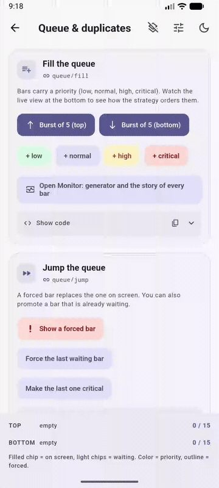
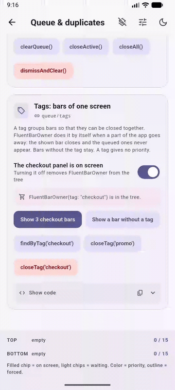

# Queue and duplicates

[Back to the README](https://github.com/rtfmko/fluent_bar/blob/v1.0.1/README.md)

## Regions and the queue

<p align="center"></p>

The screen has **two regions**, and each one shows **one bar at a time** and keeps its own queue:

| Region | Positions | Queue |
|---|---|---|
| top (called `main` in the API) | `top`, `left`, `right`, `center` | `FluentBar.mainQueue` |
| bottom | `bottom` | `FluentBar.bottomQueue` |

So a top bar and a bottom bar can be visible together, but two top bars never overlap: the second
one waits. The region follows `position` (the bar, then its type, then the config); a
`positionBuilder` only moves where the bar is drawn and does not change its region. Prefer a single queue for the whole screen? Set `enableMultiRegion: false`.

**What decides who is next.** The default `SmartQueueStrategy` orders waiting bars like this:

1. forced bars first;
2. then by priority: `critical`, `high`, `normal`, `low`;
3. bars of the same priority in the order they were requested.

```dart
FluentBar.info<void>('Synced').withPriority(FluentBarPriority.low).show();          // waits for everyone
FluentBar.error<void>('Connection lost').withPriority(FluentBarPriority.critical).show(); // next in line
FluentBar.error<void>('Session expired').forced().show();                            // replaces the bar on screen now
```

What to expect:

- A bar leaves the queue when the bar in its region closes. Nothing is shown "on top".
- A **forced** bar does not wait: it closes the bar on screen (dismiss reason `force`) and appears.
  Only a forced bar that is on screen makes another forced bar wait. A bar shown with
  `forceItem` or `forceItemFromQueue` counts as forced from then on. A waiting bar that becomes forced
  by an update replaces a non-forced bar on screen in the same way.
- Each region holds up to `maxQueueLength` waiting bars (1 to 100, 15 by default). One more is **dropped**:
  `show()` returns `null`, a warning goes to the error handlers and a `queueOverflow` event to
  analytics. Priority does not decide this: a regular bar that does not fit is dropped, however
  important it is. A forced bar is not turned away: when the queue is full it pushes out the last waiting bar,
  a forced one included. A bar pushed out (by a forced bar, a lower `maxQueueLength` or a queue strategy
  that leaves it out) gets the `queueOverflow` event and then `dismissed` with the reason `dropped`, and
  its `onDismiss` runs once. A bar that does not fit when it is shown is not created at all: `show()`
  returns `null`, only `queueOverflow` is reported and there is no `onDismiss`. The `onDismiss` and the
  events of waiting bars run after the call that ended them has finished with the queues, so a bar you
  show from that `onDismiss` is queued or shown as usual and the same call does not remove it.
- The countdown of a bar starts when its entrance animation is over (state `visible`), not when it
  is requested; a waiting bar has no countdown yet.
- Bars requested before the overlay exists (for example in `main()`) wait and appear later.

**Other strategies**, set with `defaultQueueStrategy`: `FifoQueueStrategy` (in the order of
requests, priorities ignored, forced bars first), `LifoQueueStrategy` (newest first), or your own:

```dart
class NewestFirstStrategy extends FluentBarQueueStrategy {
  const NewestFirstStrategy();

  // Returns the new queue. Entries you leave out are dropped.
  @override
  QueueOperationResult onEnqueue({
    required List<FluentBarEntry<dynamic>> queue,
    required FluentBarEntry<dynamic> incoming,
    required FluentBarConfig config,
  }) => QueueOperationResult(queue: [incoming, ...queue].take(config.maxQueueLength).toList(), shouldForce: incoming.isForce);

  // Returns the bar to show next and the rest of the queue.
  @override
  (FluentBarEntry<dynamic>?, List<FluentBarEntry<dynamic>>) onDequeue({
    required List<FluentBarEntry<dynamic>> queue,
    required FluentBarConfig config,
  }) => queue.isEmpty ? (null, queue) : (queue.first, queue.sublist(1));
}

FluentBar.patchConfig((config) => config.copyWith(defaultQueueStrategy: const NewestFirstStrategy()));
```

Look into the queue or change it: `FluentBar.activeItems`, `allQueue`, `allQueueLengthNotifier`,
`FluentBar.updateItemPriority(id: …, newPriority: …)`, `FluentBar.forceItemFromQueue(id: …)`,
`FluentBar.clearQueue()`.

> **Demo:** [Queue & duplicates → Queue settings](https://rtfmko.github.io/fluent_bar/#/queue/settings) (`queue/settings`) · [Queue & duplicates → Fill the queue](https://rtfmko.github.io/fluent_bar/#/queue/fill) (`queue/fill`) · [Queue & duplicates → Jump the queue](https://rtfmko.github.io/fluent_bar/#/queue/jump) (`queue/jump`) · [Monitor → Queues right now](https://rtfmko.github.io/fluent_bar/#/monitor/queues) (`monitor/queues`)<br>
> **API:** [`FluentBarQueueStrategy`](https://pub.dev/documentation/fluent_bar/latest/fluent_bar/FluentBarQueueStrategy-class.html) · [`SmartQueueStrategy`](https://pub.dev/documentation/fluent_bar/latest/fluent_bar/SmartQueueStrategy-class.html) · [`FluentBarPriority`](https://pub.dev/documentation/fluent_bar/latest/fluent_bar/FluentBarPriority.html)

## Duplicates

Showing "the same" bar again does not add a second one. This is what makes live updates work, and
what stops ten identical toasts after ten taps.

**What counts as the same bar**

1. your `duplicateComparator`, if you set one;
2. otherwise bars with the same `id`;
3. bars without an `id` are compared by content: fully equal bars are the same.

The search covers both regions, the bar on screen and the queues. A bar with the same `id` but
another position is still the same bar: it is updated and moves.

**What happens to a duplicate** is decided by the policy of the incoming bar:

| `FluentBarDuplicatePolicy` | Result |
|---|---|
| `update` (default) | The existing bar takes the new content. Its countdown goes on. |
| `updateAndResetTimer` | The same, and the countdown starts over. |
| `ignore` | The new bar is discarded (analytics: `ignoredDuplicate`). A changed progress still gets through. |
| `allow` | Always a separate bar. Only an unfinished progress with the same `id` is continued. |

```dart
// One bar, however often this runs.
FluentBar.toast<void>('Saved', id: 'saved').withDuplicatePolicy(FluentBarDuplicatePolicy.updateAndResetTimer).show();

// For the whole app.
FluentBar.patchConfig((config) => config.copyWith(defaultDuplicatePolicy: FluentBarDuplicatePolicy.ignore));
```

Details worth knowing:

- If both bars carry progress, only the progress, the texts and the type are taken from the new
  one; a new bar without a title removes the title. The button, callbacks and look of the bar on screen stay.
- If the existing bar is still waiting, the two are merged in the queue: the higher priority wins,
  and the bar becomes forced if either of them is. This holds for progress bars as well; the rule
  above is for the bar on screen.
- `forceItem` and `.force()` look for duplicates the same way `show()` does: a bar with the same
  `id` on screen is updated in place, a waiting one is updated and shown at once. You get the same
  entry back, never a second bar.
- A duplicate with the policy `ignore` never changes the waiting bar; if it carries a new progress,
  only the progress is applied.
- A duplicate replaces the existing bar as a whole, not field by field: the text, behavior, button
  and look come from the new one. Only a running progress is carried over, as described above.
- When a bar moves to the other region and that region is busy, `FluentBarRelocationStrategy.queueNext`
  puts it before the waiting bars that are not forced (`forceReplace` shows it in place of the bar
  there, `ignore` keeps it in its region). That is its place only at the moment of the
  move: afterwards it is sorted like any bar, so a forced or more important bar that arrives later
  goes before it.
- With `allow`, calls by `id` (`find`, `close`, an update, `updateItemPriority`) reach the first bar
  with that id: the one on screen, then the queue in its order. To reach one specific bar, keep its
  entry and call it directly.
- Bars without an `id` are compared by their content: the text, type, duration, priority, tags,
  payload, `meta`, actions, `dismissOnTap` and progress. Callbacks (`onTap`, `onDismiss`) and the
  internal uuid are not compared. A bar that differs only in its progress is a different bar.
- Bars with the same `id` but different type arguments (`<void>` and `<Order>`) are **not**
  duplicates; the library warns about it. Use one type argument per `id`.

**Your own rule.** For example, messages of one chat should update one bar without sharing an `id`:

```dart
FluentBar.patchConfig((config) => config.copyWith(
  duplicateComparator: (incoming, existing) =>
      (incoming.id != null && incoming.id == existing.id) ||
      (incoming.meta?['chat'] != null && incoming.meta?['chat'] == existing.meta?['chat']),
));

FluentBar.info<void>('Are we still on for lunch?').withTitle('Alex').withMeta({'chat': 'alex'}).show();
FluentBar.info<void>('I booked a table').withTitle('Alex').withMeta({'chat': 'alex'}).show(); // updates the first
```

> **Demo:** [Queue & duplicates → Duplicates](https://rtfmko.github.io/fluent_bar/#/queue/duplicates) (`queue/duplicates`)<br>
> **API:** [`FluentBarDuplicatePolicy`](https://pub.dev/documentation/fluent_bar/latest/fluent_bar/FluentBarDuplicatePolicy.html) · [`FluentBarDuplicateComparator`](https://pub.dev/documentation/fluent_bar/latest/fluent_bar/FluentBarDuplicateComparator.html)

## Bars of one screen

<p align="center"></p>

Bars live above every screen, so a bar outlives the screen that showed it. Usually that is the
point: "Saved" should still be there after the form closes. A bar that makes sense only on its
screen gets a **tag**, and the tag closes the whole group, the queued bars included (each of them gets its `onDismiss` and a `dismissed` event, like a bar that was on screen):

```dart
FluentBar.error<void>('Card declined').withTag('checkout').show();

FluentBar.closeTag('checkout');
```

`FluentBarOwner` does it for you when a part of the app leaves the widget tree:

```dart
class CheckoutScreen extends StatelessWidget {
  const CheckoutScreen({super.key});

  @override
  Widget build(BuildContext context) => FluentBarOwner(
    tag: 'checkout',
    child: Scaffold(
      body: FilledButton(
        onPressed: () => FluentBar.error<void>('Card declined').withTag('checkout').show(),
        child: const Text('Pay'),
      ),
    ),
  );
}
```

- **The tag is set by hand.** A bar does not know which screen called `show()`; `FluentBarOwner`
  only closes, it does not tag.
- **Bars without the tag stay**, also the ones shown from that screen.
- **A tag gives no priority.** A forced or more important bar takes the place of a tagged one as
  usual; use `.withPriority()` for importance.
- **A bar can carry several tags** (`.withTags({'checkout', 'upload'})`); any of them closes it.
- **The same screen opened twice** keeps its bars until the last `FluentBarOwner` with that tag is gone.
- **Analytics**: `metrics.tags`, and `tags` in `toFlatMap()` as `checkout,upload`.

> **Demo:** [Queue & duplicates → Tags: bars of one screen](https://rtfmko.github.io/fluent_bar/#/queue/tags) (`queue/tags`)<br>
> **API:** [`FluentBarOwner`](https://pub.dev/documentation/fluent_bar/latest/fluent_bar/FluentBarOwner-class.html) · [`FluentBar`](https://pub.dev/documentation/fluent_bar/latest/fluent_bar/FluentBar-class.html)

