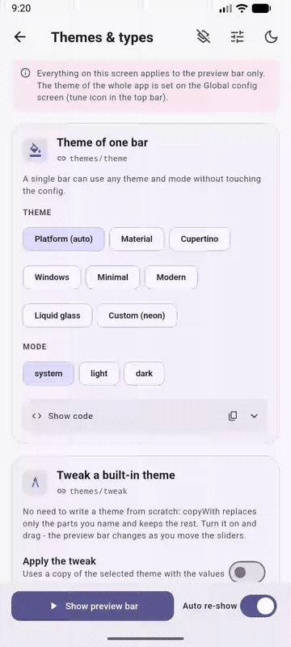

# Themes

[Back to the README](https://github.com/rtfmko/fluent_bar/blob/v1.0.1/README.md)

## Themes

<p align="center"></p>

A **theme** decides how a bar looks: colors, shape, text styles, icons, padding. What kind of bar it
is and how it behaves by default is the job of a [type](types.md).

```dart
// Built-in themes: material, cupertino, windows, minimal, modern, liquidGlass.
FluentBar.patchConfig((config) => config.copyWith(defaultTheme: FluentBarTheme.minimal));

// One bar only.
FluentBar.info<void>('Saved').withTheme(FluentBarTheme.cupertino).dark().show();

// Tweak a built-in theme instead of writing your own.
final rounded = FluentBarTheme.material.copyWith(
  borderRadius: (context, type, mode) => BorderRadius.circular(24),
);
```

Without `defaultTheme` the theme of the platform is used (`themeStyle`: `auto`, `material`,
`cupertino`, `windows`). Light or dark: `FluentBarThemeMode.system`, `light`, `dark`, on the bar
(`.dark()`, `.light()`, `.withThemeMode()`), on its type (`themeMode`) or in the config
(`defaultThemeMode`).

`copyWith` takes one callback for each method of the theme, `(context, type, mode) => value`; a few
get more arguments, and the hooks with a widget (`wrapContainer`, `wrapInteractiveContainer`,
`buildTimeoutBar`) are listed in [Builders](builders.md). The theme also has the methods
`timeoutBarColor`, `timeoutBarBackgroundColor`, `timeoutBarMinHeight`, `timeoutBarBorderRadius`,
`actionInternalPadding`, `actionDecoration`, `actionStyle`, `actionMaxLines` and `titleSpacing`,
which you override only if the default does not fit. `buildTimeoutBar` as a `copyWith` callback gets
`(context, entry, type, mode)`, without the `theme` that the method has.

**Layout and text.** On a narrow bar (a content row under about 150 px at normal text size, scaled
with the text size) the action button goes under the text instead of beside it. Text with unpaired
UTF-16 surrogates (a lone half of an emoji, for example) is repaired: each one is replaced by U+FFFD in
the title, the message, the action label and the progress label, so `Text` never throws. The
`windows` theme uses a readable action color in dark mode.

A custom theme extends `FluentBarTheme` and needs three methods: `boxDecoration`, `titleStyle` and
`messageStyle`. Everything else has a default. A method that throws is reported and the built-in
theme of the platform draws the bar. Themes plug into the same lookup order as every setting: see
[Overriding settings](settings.md#overriding-settings).

> **Demo:** [Themes & types → Theme of one bar](https://rtfmko.github.io/fluent_bar/#/themes/theme) (`themes/theme`) · [Themes & types → Tweak a built-in theme](https://rtfmko.github.io/fluent_bar/#/themes/tweak) (`themes/tweak`)<br>
> **API:** [`FluentBarTheme`](https://pub.dev/documentation/fluent_bar/latest/fluent_bar/FluentBarTheme-class.html)
